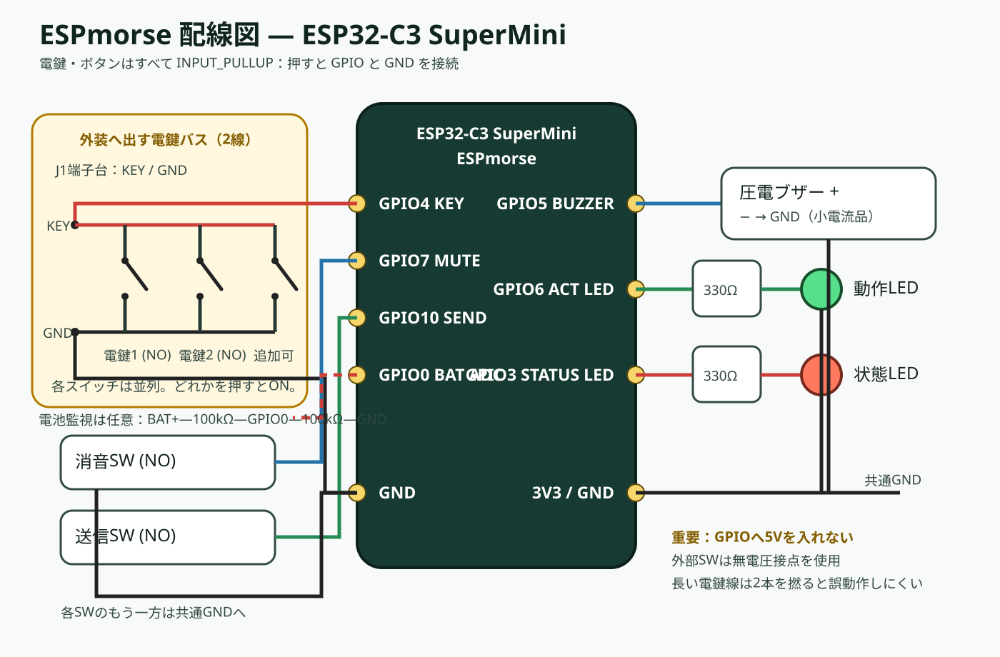

# ESPmorse 配線

| 機能 | ESP32-C3ピン | 接続 |
|---|---:|---|
| 電鍵 | GPIO4 | NOスイッチを介してGND |
| ブザー | GPIO5 | 圧電ブザーの＋（－はGND） |
| 動作LED | GPIO6 | 330Ω → LED → GND |
| 状態LED | GPIO3 | 330Ω → LED → GND |
| 消音ボタン | GPIO7 | NOスイッチを介してGND |
| 送信ボタン | GPIO10 | NOスイッチを介してGND |
| 電池監視（任意） | GPIO0 | 100kΩ/100kΩの分圧中点 |

## 外装用の電鍵配線

GPIO4とGNDの2線を端子台（J1）へ出します。外装内では2本を平行に延ばし、電鍵を梯子の横桟のように並列で追加できます。すべて通常開（NO）接点です。どれか1つを押すとGPIO4がGNDへ落ち、ONとして認識されます。

- 外部スイッチには電圧を出すタイプではなく、無電圧接点を使います。
- GPIO4は内部プルアップ済みなので、外付けプルアップ抵抗は不要です。
- 配線が長い場合はKEY/GNDの2本を撚り、モーター線や電源線から離します。
- 誤入力が出る場合は、ESP側のGPIO4–GND間へ100nFのコンデンサを追加できます。
- ESP32-C3のGPIOへ5Vを直接入れないでください。
